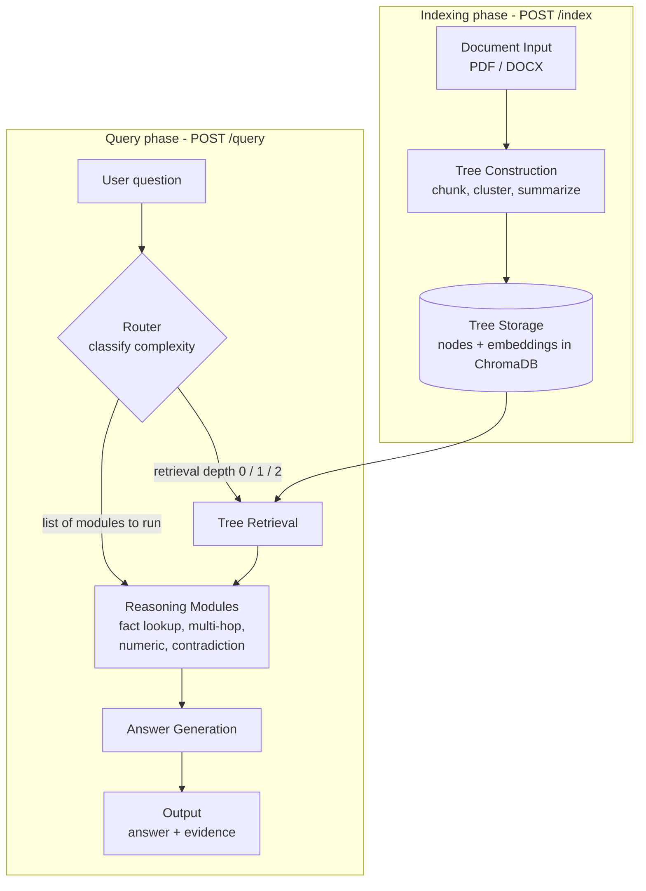

# GRAFT Architecture

GRAFT (Gated Retrieval Activation Framework for Trees) is an adaptive RAG system.
Instead of treating every question the same way, it decides **how deep to search**
and **which reasoning modules to run** for each question. This page explains how
the pieces fit together so you can understand the system without reading the code.

## Pipeline overview

The system has two phases: **indexing** (done once per document) and
**querying** (done for every question).



## Stages

| Stage | What it does | Code |
|---|---|---|
| Document Input | Accepts a PDF or DOCX upload | `api/`, `indexing/ingest.py`, `indexing/parser.py` |
| Tree Construction | Splits text into chunks (leaves), clusters similar chunks, and summarizes each cluster. Repeats upward until one root summary exists | `indexing/` |
| Tree Storage | Saves the tree. Node embeddings live in ChromaDB | `tree_store/`, `vector_store/`, `indexing/vector_store/` |
| Question Routing | Classifies the question as `simple`, `moderate` or `complex`, then picks the retrieval depth and the modules | `router/` |
| Tree Retrieval | Searches the tree at the depth the router chose | `retrieval/` |
| Reasoning Modules | Run only if the router activated them | `modules/` |
| Answer Generation | Combines module output and evidence into the final answer | `generation/` |
| Output | `/query` returns the answer with its supporting evidence | `api/` |

## The tree

Leaves are raw text chunks (level 0). Above them are progressively more abstract
summaries (level 1), and at the top is a single root summary (level 2). Shallow
retrieval reads detail; deeper retrieval also reads the summaries, which helps with
questions that span a whole document.

## The router: the key idea

The router (`router/__init__.py`) is what makes GRAFT adaptive. It makes two decisions
for every question.

### 1. How complex is the question?

It computes a **complexity score between 0 and 1** by adding weighted signals:

| Signal | What it looks at |
|---|---|
| Length | Number of words in the question |
| Clauses | How many separate requests are packed together (commas, "and", "then", ...) |
| Extra operations | How many different reasoning operations are requested (compare, explain, list, aggregate, detect conflict) |
| Numeric intent | Numbers, tables, sums, averages |
| Multi-hop intent | Words like compare, difference, across, both |
| Contradiction intent | Words like conflict, contradict, outdated |

The score is compared against **two fixed thresholds** from `config.py`
(`router_threshold_simple` and `router_threshold_complex`):

- score below the simple threshold -> `simple`
- score above the complex threshold -> `complex`
- anything in between -> `moderate`

The router also reports a confidence value. It is low when the score sits close to a
threshold and high when the answer is clear-cut.

### 2. What does that decision control?

| Complexity | Retrieval depth | Modules activated |
|---|---|---|
| `simple` | 0 (leaves only) | `fact_lookup` |
| `moderate` | 1 (leaves + summaries) | `fact_lookup` + modules the question hints at |
| `complex` | 2 (leaves + summaries + root) | `fact_lookup` + modules the question hints at |

For `moderate` and `complex` questions, modules are chosen by what the question
asks for:

- conflict words -> `contradiction_detection`
- numbers or tables -> `numeric_reasoning`
- comparison words, or more than one reasoning operation -> `multi_hop`
- a `complex` question with no hints still gets `multi_hop`

This is why a simple question stays cheap: it reads only the leaves and runs a single
module. See [ADR 0002](adr/0002-router-fixed-thresholds.md) for why the router uses
fixed thresholds.

## Retrieval

Retrieval searches the tree up to the depth the router selected. If a document's tree
does not have the requested level (for example, a very short document), it falls back
to the leaves.

## Reasoning modules

| Module | Purpose |
|---|---|
| `fact_lookup` | Finds direct answers in the retrieved text. Always runs |
| `multi_hop` | Combines information from several passages or documents |
| `numeric_reasoning` | Handles figures, tables and aggregates |
| `contradiction_detection` | Compares claims across sources and flags conflicts |

All modules follow the shared output contract described in
[interfaces.md](interfaces.md).

## Answer generation

Generation merges the activated modules' output into one answer and attaches
de-duplicated, ordered evidence so every claim can be traced to a source passage.

## Rendering the use-case diagram

The use-case diagram lives in `docs/use-cases.puml` and is written in
[PlantUML](https://plantuml.com). Render it with the `smetana` layout engine, which is
built into PlantUML and does not need Graphviz installed.

**Command line** (requires Java and `plantuml.jar`):

```bash
java -jar plantuml.jar -Playout=smetana docs/use-cases.puml
```

This writes `docs/use-cases.png`. Add `-tsvg` to get an SVG instead:

```bash
java -jar plantuml.jar -Playout=smetana -tsvg docs/use-cases.puml
```

**VS Code:** if you use the PlantUML extension, add `-Playout=smetana` to its command
arguments in your settings, or put `!pragma layout smetana` on the line after
`@startuml` in the `.puml` file.

Keep `docs/use-cases.puml` in the repository and re-render it whenever the use cases
change.

## Related documents

- [README](../README.MD): project overview and setup
- [interfaces.md](interfaces.md): input/output contracts between components
- [scope.md](scope.md): MVP scope
- [Architecture decision records](adr/): why the system is built this way